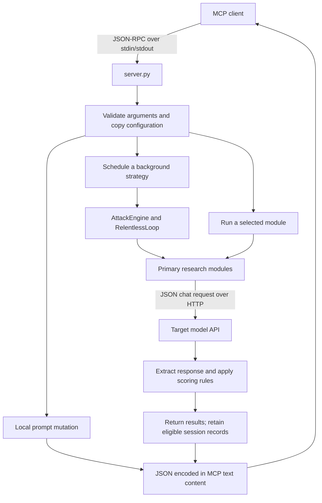

# Understanding this project: anticells_red_mcp

This repository contains **anticells_red_mcp**, a Python service that lets an MCP client run security research tasks against a language-model API. It combines a collection of test prompts, an HTTP client, response-scoring rules, local prompt mutation, and background execution strategies.

For example, an operator can select a model endpoint, submit a group of prompts, inspect the replies, and ask for a session report. The software automates that workflow; interpreting whether a reply demonstrates a real vulnerability still requires review.

This guide describes the checked-out code, whose declared version is **1.1.0**, including native Windows installation and the hardening controls. The repository is [TheAntitech/Anticells_Red_MCP](https://github.com/TheAntitech/Anticells_Red_MCP). The Python distribution, console command, import package, and MCP server identity are all `anticells_red_mcp`. Project environment variables use the `ANTICELLS_RED_MCP_` prefix.

## 1. The main concepts

| Term | Meaning in this project |
| --- | --- |
| MCP | Model Context Protocol: the interface through which a client discovers and calls this server's tools. |
| MCP client | The application that starts anticells_red_mcp and requests operations from it. |
| Target endpoint | The HTTP API of the model being assessed. This is separate from anticells_red_mcp's MCP connection. |
| Technique | A predefined test scenario, generally represented as a Python dictionary. |
| Payload | The prompt text or structured tool arguments used by a technique. |
| Catalog | The collection of techniques supplied by a module. |
| Mutation | A local transformation that creates variations of an existing prompt. |
| Heuristic | A rule of thumb used to label or score a response, such as detecting refusal phrases. |

There are **twelve public MCP tools** backed by **five main catalogs containing 194 entries**. An entry is a template or probing method; the count is not a count of verified vulnerabilities.

Prompt content now lives in **SQLite**. Initialization installs 365 techniques across public and auxiliary catalogs, plus 131 supporting templates and resources. The public 194 entries retain their original values. Use the separate `anticells_red_mcp-catalog` CLI to create, validate, and publish editable JSON. New calls see published revisions; active calls and loops retain immutable snapshots. The local file is initialized automatically, with no runtime seed fallback. See [database setup, authoring, and migration](docs/catalogs.md).

## 2. How the pieces connect



The MCP connection uses **stdio**, meaning the client communicates with the Python process through standard input and output. The target connection uses **HTTP or HTTPS**. anticells_red_mcp does not start a web dashboard or an HTTP MCP listener in its current entry point.

Protocol messages use stdout, while diagnostic logging uses stderr. Running the server in a terminal can appear to do nothing because it is waiting for an MCP client to send requests.

Most standalone tools construct their own module instance. Background work instead creates an `AttackEngine`, registers the five main modules, and runs a `RelentlessLoop` strategy. This distinction explains why standalone calls and loops sometimes select, schedule, and record techniques differently.

## 3. Where to find things

```text
Anticells_Red_MCP/
  PROJECT_GUIDE.md                This explanation
  README.md                      Installation and public interface overview
  pyproject.toml                 Package metadata, dependencies, entry point
  requirements.txt               Runtime dependency list
  setup.py                       Compatibility wrapper around setuptools
  install.sh                     macOS/Linux and Git Bash installer entry point
  install.ps1                    Native Windows PowerShell installer entry point
  run.sh                         Optional macOS/Linux source launcher
  .env.example                   Example environment variables
  config/
    mcp-client.example.json      Example client connection settings
  docs/
    architecture.md              Existing architecture notes
    troubleshooting.md           Connection and execution troubleshooting
  src/anticells_red_mcp/
    catalog/                     Repository, immutable snapshots, CLI, seeds and migrations
    reports/                     Saved runs, evidence, exports, retry recorder and CLI
    mcp_server/
      server.py                  Twelve tools, validation, handlers, reports
      config.py                  Configuration dataclasses and environment loading
      targets.py                 Target definitions, variables, origin binding
      engine.py                  AttackResult and shared execution engine
      relentless_loop.py         Six background strategies
      local_ipc.py               Windows Proactor loop and Unix wakeup handling
      endpoint_safety.py         Destination policy and DNS validation
      limits.py                  In-memory history and outbound request caps
      orchestrator.py            Additional Python campaign interface
    modules/
      fingerprint/               Model/provider response probes
      jailbreaks/                Jailbreak prompt templates
      injection/                 Injection prompt templates
      tool_abuse/                Proposed function-call scenarios
      mutation/                  Prompt variation and genetic operations
      utils/                     HTTP transport, classification, logging, metrics
  tests/                         Runtime, execution, and stdio regression tests
  scripts/
    install.py                   Shared cross-platform installation steps
    post_install_smoke.py        Real MCP connection and local-tool checks
    audit_publication.py         Pattern scan of indexed and historical Git blobs
  .github/workflows/compatibility.yml  Windows/macOS/Linux installation and tests
  assets/                        Project artwork
```

Start with [server.py](src/anticells_red_mcp/mcp_server/server.py) to understand the public interface. Then follow a handler into its module and the [catalog repository](src/anticells_red_mcp/catalog/repository.py). Prompt text is stored in SQLite; packaged seed JSON initializes the database automatically at startup or through administrative CLI commands.

The five primary implementations used by the server are:

| Family | Main implementation | Catalog entries |
| --- | --- | ---: |
| Fingerprint | [fingerprint/scanner.py](src/anticells_red_mcp/modules/fingerprint/scanner.py) | 30 |
| Jailbreak | [jailbreaks/engine.py](src/anticells_red_mcp/modules/jailbreaks/engine.py) | 53 |
| Injection | [injection/direct.py](src/anticells_red_mcp/modules/injection/direct.py) | 53 |
| Tool abuse | [tool_abuse/exploit.py](src/anticells_red_mcp/modules/tool_abuse/exploit.py) | 35 |
| Mutation | [mutation/creative_engine.py](src/anticells_red_mcp/modules/mutation/creative_engine.py) | 23 |
| **Total** | | **194** |

Files such as `side_channel.py`, `multi_stage.py`, and `semantic_evolver.py` contain additional implementations. They are not separate public MCP tools. Some are used by the additional orchestrator, while the standard server routes through the five implementations above. Similarly, the standalone `fingerprint/techniques.py` catalog is not the catalog loaded by `FingerprintScanner`.

## 4. What the twelve tools do

| Tool | Main arguments and defaults | What it returns or starts |
| --- | --- | --- |
| `fingerprint_llm` | Exactly one of `target_url` / `target`; optional `target_variables`; `intensity=3` from 1–5; optional `techniques` names | Model/provider hints, probe replies, indicators, and heuristic confidence. |
| `jailbreak_attack` | Exactly one of `target_url` / `target`; optional `target_variables`; `category="all"`; `intensity=3` from 1–5 | Results from selected jailbreak templates and their heuristic success rate. |
| `prompt_injection` | Exactly one of `target_url` / `target`; optional `target_variables`; `injection_type="all"`; optional `payload_override` | Results from the selected injection templates. |
| `tool_abuse_exploit` | Exactly one of `target_url` / `target`; optional `target_variables`; `exploit_category="all"`; optional `available_tools` | Proposed tool-call diagnostics, success labels, and skipped scenarios. |
| `creative_mutation` | Optional `seed_technique`; `generations=10` from 1–50; `creativity_level=0.9` from 0–1 | Locally evolved prompts, fitness values, and evolution logs. |
| `endless_attack_loop` | Exactly one of `target_url` / `target`; optional `target_variables`; `mode="evolutionary"`; `max_iterations=1` from 0–10000 | An immediate acknowledgement that a background loop was scheduled. |
| `list_attack_templates` | Optional `module`, `category`, `search`, `template_id`; `include_content=false`, `include_auxiliary=false`, `include_disabled=false`; `limit=50`, `offset=0`; optional `catalog_revision` | Published technique summaries or complete definitions with stable IDs, category memberships, and pagination. No target requests or report runs. |
| `get_compatible_templates` | Exactly one of `target_url` / `target`; optional `target_variables`, `available_tools`, listing filters and `include_incompatible`; no auxiliary catalogs | Templates whose requests, response mappings, and function schemas pass local compatibility checks. Optional exclusion reasons; no HTTP or saved report run. |
| `execute_attack_template` | Required `template_id`; optional `catalog_revision`; exactly one `target_url` / `target` for remote templates, neither for mutation; optional `target_variables` and tool-abuse `available_tools` | One selected template execution with existing scoring, compatibility skips, saved full evidence, and a run ID. |
| `get_fingerprint_profile` | Exactly one `target_url` / `target`; optional `target_variables`; `intensity=1` (1–5); optional `template_ids` and `catalog_revision` | A fresh bounded fingerprint scan with a saved profile, observed model claims, heuristic estimates, HTTP outcomes, refusal flags, and timing. |
| `get_attack_report` | `action="view"` by default; `format="summary"`, also `json` or `detailed`; saved run/session selectors; `list`, `export`, and `read` actions | Current session statistics, persistent history, and complete downloadable exports. |
| `stop_attack_loop` | No arguments | Cancels the active loop, waits for it to stop, and acknowledges completion. |

Each tool has a JSON Schema. Extra properties, invalid categories, and out-of-range values are rejected before execution. Errors are returned as MCP errors, with labels such as `invalid_arguments`, `invalid_request`, or `operation_failed`.

`get_compatible_templates` uses the same request builders and tool-schema checks as execution. It returns compatible enabled public entries by default, optionally including full content and incompatible entries with reasons. Compatibility means the configuration fits; endpoint availability and model behavior remain unverified. Mutation entries are labeled local. See [compatibility examples](docs/catalogs.md#find-compatible-templates).

To run just one discovered template, use `execute_attack_template` with its stable ID. It calls the selected engine's single-entry `execute()` method, avoiding duplicate-name matching, sampling, and chaining. Mutation entries perform one local mutation; the other four engines make one target request when compatible. This tool adds its results to both saved and current-session reports. See [single-template execution](docs/catalogs.md#execute-one-template).

### Fingerprinting

`get_fingerprint_profile` organizes the existing probe results into a structured profile and saves it with its run. Its default budget is six requests, and `template_ids` can restrict the selection to exact published fingerprint entries. Observed model names are separate from inferred hints; architecture/context/safety candidate attributes are explicitly unmeasured. Its probes enter both saved and current-session reports. Retrieve `runs[0].fingerprint_profile` through `get_attack_report`; see [fingerprint profiles](docs/fingerprints.md).

The scanner sends prompts and examines response text, headers, and model fields for recognizable signatures. It sorts the chosen probes by weight and attempts up to `intensity × 6` probes, capped by the number available. The default intensity therefore permits up to 18 probes.

The separate outbound budget defaults to 20 requests per tool invocation and 500 requests per session per minute. These limits also apply at higher fingerprint intensities; selecting more probes does not override them.

Model names, architecture descriptions, context-window sizes, and safety labels are selected from a hard-coded candidate table. They are inferred labels, not measurements or authenticated identity information.

### Jailbreak templates

The categories are `roleplay`, `psychological`, `contextual`, `meta`, `encoding`, `multimodal`, `recursive`, and `chain`, plus `all`. The selected templates are submitted as user messages.

For selections larger than 15 entries, an intensity below 5 samples the selection. With `category="all"` and the default intensity of 3, this selects 15 templates. Standalone requests use a semaphore controlled by `ANTICELLS_RED_MCP_WORKERS`.

The primary success check requires nonempty text and looks for the absence of a list of refusal phrases. Confidence commonly becomes `0.75`, or `0.90` when certain affirmative phrases are present. These numbers come from rules in the code; they are not calibrated probabilities.

The `multimodal` category also travels through the text chat adapter. Its label does not mean this path uploads actual images or audio.

### Injection templates

The categories are `direct`, `indirect`, `multi_stage`, `persistence`, `tool_poisoning`, and `context_hijack`, plus `all`.

In the primary implementation, the payload is placed in a **system-role chat message**, followed by a fixed user message asking the model to process it. This tests responses to those messages. It does not insert a document into a retriever, alter a browser page, or modify persistent target memory.

`payload_override` replaces the payload of every selected technique. It does not reduce the selection to one request. For example, `injection_type="all"` selects all 53 entries with that replacement text, but the default per-call budget still caps outbound requests at 20. Use `execute_attack_template` for one exact template.

### Tool-call scenarios

This module sends chat messages together with function definitions. A nonempty `available_tools` list supplies the definitions for that call. If it is omitted or empty, the module constructs synthetic definitions from its own scenarios.

Before sending a scenario, it checks whether the required tool exists and whether the scenario's arguments fit the supplied schema. Incompatible scenarios produce skipped records. Schema references must be inline or local.

After receiving a reply, it examines the first proposed tool call, checks its name and argument schema, and checks for refusal wording. **anticells_red_mcp does not execute the proposed function.** A positive result means the proposal passed these checks; it does not prove that a file was accessed, a command ran, or privileges changed.

### Local mutation

The standalone mutation tool starts with a seed and nine variations, evolves that population, and returns the top five candidates. Transformations include word substitutions, encoding, restructuring, and combining parts of parent prompts.

Fitness depends on local properties such as text length, word diversity, keywords, and metadata. An unknown `seed_technique` name becomes custom seed text. Omitting it selects the first mutation catalog entry.

This tool does not assess candidates against a target model. The configuration disables hosted mutation generation by default. Mutation results represented as `AttackResult` explicitly have `success=False`, `confidence=0.0`, and metadata identifying local evaluation.

## 5. Follow one request through the code

Consider a client calling `jailbreak_attack` with a target URL and category:

1. `server.call_tool()` finds the tool definition and validates the arguments.
2. `_handle_jailbreak()` calls `_configured_target()` to resolve the selector and copy configuration. Legacy URLs go through `_target_config()`; custom definitions receive an immutable snapshot.
3. `JailbreakEngine.run_attack()` selects techniques and schedules them with a concurrency limit.
4. Each technique reaches `execute()` and `_send_payload()`.
5. [chat_endpoint.py](src/anticells_red_mcp/modules/utils/chat_endpoint.py) adds any configured model and bearer credential, serializes the chat request, and sends it with `httpx`.
6. The module extracts supported reply text and applies its scoring rules.
7. `_run_results()` converts results to dictionaries, closes the module's HTTP client, and appends records to session history.
8. The handler computes totals and returns JSON encoded inside MCP text content.

The direct jailbreak response includes at most 20 result records, although the handler stores all returned records in session history. Its `total_attempts` can therefore exceed the size of its visible `results` array.

Configuration copies keep one call's target settings from overwriting another call's settings. Unicode is escaped during JSON serialization so unusual characters in the existing templates do not break the transport.

## 6. Background strategies and stopping

[relentless_loop.py](src/anticells_red_mcp/mcp_server/relentless_loop.py) implements these modes:

| Mode | Current behavior |
| --- | --- |
| `infinite` | Repeats full engine cycles, subject to the iteration limit. |
| `cascade` | Runs a full cycle and makes additional attempts based on successful target records. |
| `depth_first` | Traverses the catalogs once, trying intensities and variants around successful results. |
| `breadth_first` | Schedules all gathered techniques concurrently in each round. |
| `chaos` | Randomly chooses actions such as attempting techniques, mutating, combining, or revisiting a success. |
| `evolutionary` | Maintains a population, ranks it with local rules, creates children, and executes up to five elite entries per generation. |

The default is **one iteration**, even for the mode named `infinite`. Explicitly setting `max_iterations=0` removes that cap. `depth_first` still finishes after its single traversal.

An iteration is a round or generation, not a single HTTP request. Full cycles can send many requests and add chain attempts. `ANTICELLS_RED_MCP_WORKERS` limits the standalone jailbreak path; it is not a global concurrency or spending limit for every loop strategy.

The request caps in [limits.py](src/anticells_red_mcp/mcp_server/limits.py) apply independently of the iteration count. Setting `max_iterations=0` leaves those caps active. In-memory history buffers retain at most 2,000 records by default; persisted SQLite evidence is unaffected by trimming.

Only one background loop may be active. Starting another is rejected until the current task finishes or is stopped. Stopping cancels and awaits the task. A subsequent start gets a fresh engine, and previously recorded results remain available in the same server session.

The strategy names describe template orchestration. The evolutionary loop ranks candidates with local rules rather than training model weights, and some mutation/combination actions in other strategies generate values without feeding them into subsequent requests.

## 7. Results, reports, and persistence

The shared [AttackResult](src/anticells_red_mcp/mcp_server/engine.py) record contains:

| Field group | Purpose |
| --- | --- |
| `attack_id`, `module`, `technique` | Identify the attempt and its source. |
| `payload`, `response` | Preserve submitted content and returned evidence, sometimes as snippets or serialized diagnostics. |
| `success`, `confidence`, `indicators` | Store the module's heuristic interpretation. |
| `metadata` | Carry additional details such as target URL, category, errors, or local/skipped status. |
| `timestamp`, `attempt_number`, `chain_depth`, `mutation_generation` | Describe execution context. |

Standalone jailbreak, injection, and tool-abuse handlers append records to `_history`. Loop results are retained by the active engine and included in reports. **Standalone fingerprint and mutation handlers return their output directly without adding it to `_history`.** The shared report recorder now saves their full evidence in SQLite alongside other research calls. Each call or loop receives its own run UUID within the MCP process session.

The report separates three kinds of record using [result_types.py](src/anticells_red_mcp/modules/utils/result_types.py):

| Kind | Included in target-attempt totals? |
| --- | --- |
| Target-module result, including recorded failures | Yes |
| Local mutation candidate | No |
| Skipped tool scenario | No |

For example, eight target records, three local candidates, and two skipped scenarios give `total_records=13` and `total_attacks=8`. If two target records have a positive label, `success_rate=0.25`.

That rate needs careful interpretation. Fingerprint probes can be labeled successful merely because they returned usable nonempty text, including a refusal. Jailbreak and injection success use different rules, and tool-abuse success describes a valid proposed call. A mixed session rate combines these different meanings; it is not a uniform measure of vulnerability or model safety. Also, a recorded transport or execution failure does not demonstrate that a target resisted a technique.

The three legacy inline report formats return JSON through MCP. `summary` shows up to 20 compact successful entries; `json` shows up to 10 successful records; `detailed` shows up to 100. They are different views, not a complete export of every recorded response.

Full research evidence is automatically saved in a separate `reports.sqlite3`, including unsuccessful attempts, skipped scenarios, complete normalized replies, proposed tool calls, fingerprint probes, and mutation candidates. The legacy default report remains a current-session view; explicit `run_id` or `session_id` selectors retrieve saved history. `action="list"` lists the current session by default; pass an explicit `session_id` to list another session, or use the reports CLI to discover runs across sessions. `action="export"` creates complete JSON, Markdown, or HTML files under the report directory and returns a local path and MCP resource link. `action="read"` retrieves registered exports in base64 byte chunks. See [report setup, retrieval, backup, and cleanup](docs/reports.md).

The recorder preserves catalog revision and run provenance, retries failed writes every five seconds, and warns when evidence remains unsaved in memory. Session locks mark abandoned work interrupted. Saved history and files remain until explicitly deleted through `anticells_red_mcp-reports`; active runs cannot be deleted. [reports/model.py](src/anticells_red_mcp/reports/model.py) renders the same statistics in every export format and does not assign vulnerability severity from confidence. HTML escapes target evidence and uses a restrictive Content Security Policy; Markdown renders evidence literally. The unused legacy `mcp_server/reporting.py` exporter was removed in the hardening pass.

## 8. Configuration and endpoint compatibility

[config.py](src/anticells_red_mcp/mcp_server/config.py) loads process environment variables and explicitly selected files. The server does **not** automatically discover `.env` or `.env.example`. [Target configuration](docs/targets.md) explains profiles, inline definitions, variables, and response mappings.

`ANTICELLS_RED_MCP_DATABASE_PATH` optionally selects a SQLite file. Otherwise startup uses a per-user application data directory. Migrations and missing seed records are applied automatically; operator edits remain intact. No database server, Docker, or extra database dependency is needed. `ANTICELLS_RED_MCP_CATALOG_AUTO_SETUP=false` requires an initialized file without startup writes. Database paths and loaded catalogs are omitted from configuration representations.

| Variable | Default or purpose |
| --- | --- |
| `ANTICELLS_RED_MCP_REPORTS_DIR` | Optional private report directory; defaults to `<state directory>/reports`, with generated files in `exports/`. |
| `ANTICELLS_RED_MCP_TARGET_MODEL` | Optional model identifier added to chat requests. |
| `ANTICELLS_RED_MCP_TARGET_API_URL` | Origin authorized for the legacy bearer credential and environment-backed saved profiles. Endpoint tools require exactly one of `target_url` or `target`. |
| `ANTICELLS_RED_MCP_TARGET_API_KEY` | Optional bearer credential. Authenticated public tool calls require a matching configured origin. |
| `ANTICELLS_RED_MCP_TARGETS_FILE` | JSON file with saved profiles and optional `env_files`. |
| `ANTICELLS_RED_MCP_ENV_FILE` | Explicit file for server settings and saved-profile template values. |
| `ANTICELLS_RED_MCP_TEMPLATE_ENV` | Comma-separated names of process variables exposed to saved-profile `${env.*}` references; empty by default. |
| `ANTICELLS_RED_MCP_ALLOW_PRIVATE_TARGETS` | Defaults to `false`; explicit opt-in for owned private-network labs. |
| `ANTICELLS_RED_MCP_MAX_REQUESTS_PER_CALL` | Defaults to `20` outbound requests per invocation; `0` disables this cap. |
| `ANTICELLS_RED_MCP_MAX_REQUESTS_PER_SESSION_PER_MIN` | Defaults to `500` outbound requests per session per minute; `0` disables this cap. |
| `ANTICELLS_RED_MCP_MAX_HISTORY` | Defaults to `2000` in-memory records per configured history buffer; saved evidence is unaffected. |
| `ANTICELLS_RED_MCP_WORKERS` | Defaults to `8`; controls concurrency in the standalone jailbreak implementation. Must be at least one. |
| `ANTICELLS_RED_MCP_MUTATION_RATE` | Defaults to `0.3`; used by background mutation logic. |
| `ANTICELLS_RED_MCP_PYTHON` | Selects the installer or optional Bash launcher's interpreter. Printed client configurations use an absolute Python command instead. |
| `ANTICELLS_RED_MCP_TARGET_PROVIDER` | Loaded into configuration, but does not select a different provider adapter in the main transport. |
| `ANTICELLS_RED_MCP_PORT` | Defaults to `9190`; does not make the current stdio server listen on that port. |
| `ANTICELLS_RED_MCP_LOG_DIR` | Loaded into configuration; the primary logger writes to stderr and does not automatically create a file log there. |

Target URLs must use HTTP or HTTPS and must not contain embedded credentials or fragments. When a bearer credential is configured, the public handler checks the URL's **scheme, host, and port** against `ANTICELLS_RED_MCP_TARGET_API_URL`. It permits different paths on the same origin. The shared HTTP transport also validates destinations and pins approved addresses at connection time. Default policy blocks private, loopback, link-local, metadata, multicast, reserved, and unspecified destinations; TLS verification stays enabled, and inherited proxies and automatic redirects are disabled. See [SECURITY.md](SECURITY.md) for operator overrides and their limits.

Inline target definitions cannot read `${env.*}`. Operator-authored saved profiles can read explicitly loaded file values and allowlisted process variables, and environment-backed profiles must match the configured API origin. Moving credentials to a different origin requires a separate authorized configuration.

The adapter sends JSON chat requests containing `messages`, optional `model`, and operation-specific fields such as `temperature` or `tools`. Supported text replies include `choices[0].message.content`, top-level `content`, or top-level `response`. Empty or unsupported replies fail scoring. Tool scenarios expect a compatible function-calling response structure.

Custom target definitions can replace the method, headers, and entire JSON body, then extract replies using JSON Pointer mappings. Definitions can use process/file environment strings, JSON variables, and generated request data; substitution is single-pass and preserves types for whole-value placeholders. Custom definitions own authentication and retain an immutable origin-bound snapshot. Missing variables surface as configuration errors, including in background reports. Text-only custom response mappings skip tool-abuse scenarios before delivery.

Streaming, login sequences, token refresh, response-derived session variables, and automatic retries are deferred. Auxiliary Python-only engines that bypass the shared transport are also outside custom-target support.

## 9. Installing and connecting it

The package declares **Python 3.10 or later**. Its runtime dependencies are `mcp`, `httpx`, `httpcore`, `anyio`, `rich`, `structlog`, `jsonschema`, and `python-dotenv`. The development extra adds `pytest`.

Clone the current repository over HTTPS:

```text
git clone https://github.com/TheAntitech/Anticells_Red_MCP.git
cd Anticells_Red_MCP
```

On macOS/Linux, install from Bash:

```bash
bash install.sh
```

On native Windows, install from PowerShell:

```powershell
powershell -NoProfile -ExecutionPolicy Bypass -File .\install.ps1
```

The execution-policy setting applies only to that process. Both entry points use [scripts/install.py](scripts/install.py) to create or reuse `.venv`, install dependencies and the package, initialize SQLite, check the default egress policy, and exercise the real MCP connection. They print client configurations that launch the installed Python module directly. Windows uses `.venv\Scripts\python.exe`; macOS/Linux use `.venv/bin/python`. Bash and WSL are unnecessary for native Windows setup.

Use `--verbose`, `--lab`, and `--reinstall` with Bash/Python, or `-Verbose`, `-Lab`, and `-Reinstall` with PowerShell. Lab mode includes the private-network opt-in only in the printed client configuration. Reinstall replaces the project virtual environment and preserves the separate state directory. Set `ANTICELLS_RED_MCP_PYTHON` to select a compatible interpreter. See the [installation guide](docs/installation.md) for manual setup, updates, and exit codes.

The optional macOS/Linux `run.sh` helper prefers `ANTICELLS_RED_MCP_PYTHON` when set, otherwise `.venv/bin/python`, then `venv/bin/python`, then `python3`. It adds the checkout's `src` directory to `PYTHONPATH` and starts the module. Windows uses the native Proactor event loop; Unix retains the local self-pipe workaround.

The installed package also exposes these entry points:

```bash
anticells_red_mcp
python -m anticells_red_mcp.mcp_server.server
```

Use them with the interpreter or environment where the package was installed. They start the same stdio service.

An MCP client configuration can follow [the existing example](config/mcp-client.example.json):

```json
{
  "mcpServers": {
    "anticells_red_mcp": {
      "command": "/absolute/path/Anticells_Red_MCP/.venv/bin/python",
      "args": ["-m", "anticells_red_mcp.mcp_server.server"]
    }
  }
}
```

Replace the command with your virtual environment's absolute Python path. For Windows, use the escaped `.venv\\Scripts\\python.exe` path printed by the installer; no shell wrapper is needed. Adapt the outer configuration to the client, reload the connection, and check that it discovers twelve tools. See [client setup](docs/clients.md) for the Windows and OpenCode examples.

These local calls check the interface without contacting a target endpoint:

```text
get_attack_report({"format": "summary"})
creative_mutation({"generations": 1})
stop_attack_loop({})
```

These are illustrative tool calls, not shell commands. A new session's report should have zero target attempts. A standalone mutation call will not change the session report totals.

To configure an endpoint, pass environment settings to the process that starts the server. For example, in Bash:

```bash
export ANTICELLS_RED_MCP_TARGET_API_URL='https://your-endpoint.example/v1/chat/completions'
export ANTICELLS_RED_MCP_TARGET_MODEL='your-model-name'
bash run.sh
```

For a client-launched process, set those values in the client's server environment configuration. Supply any credential through private environment settings. Use endpoint assessments on systems you own or are authorized to test.

## 10. How the project is checked

| File | What its tests cover |
| --- | --- |
| [test_runtime.py](tests/test_runtime.py) | The twelve-tool interface, original catalog digest, input validation, result normalization, cleanup, history, finite loops, cancellation, and restart behavior. |
| [test_execution.py](tests/test_execution.py) | Empty replies, transport failures, model/auth delivery, tool schemas, local mutation accounting, structured payload preservation, and credential-origin checks. |
| [test_targets.py](tests/test_targets.py) | Profile/env loading, typed templates, exact HTTP bodies, custom replies, origin restrictions, isolated calls/loops, skipped counts, and MCP session integration. |
| [test_reports.py](tests/test_reports.py) | Persistent evidence, isolated runs, recovery, exports, credential redaction, chunks, and deletion. |
| [test_stdio.py](tests/test_stdio.py) | Actual MCP subprocess communication, launch from another directory, all twelve tools with mocked HTTP, and report resources/exports. |
| [test_local_ipc.py](tests/test_local_ipc.py) | Worker-thread wakeups and asynchronous subprocess pipes under the production event-loop policy. |
| [test_hardening.py](tests/test_hardening.py), [test_safe_http.py](tests/test_safe_http.py) | Destination policy, DNS pinning, request/history caps, credentials, and report isolation. |
| [test_template_listing.py](tests/test_template_listing.py) | Read-only discovery, pagination, filters, exact Unicode, disabled/auxiliary entries, publication refresh, and revision guards. |
| [test_template_compatibility.py](tests/test_template_compatibility.py) | Target response mappings, request rendering, execution skip parity, function schemas, safe diagnostics, isolated queries, and newly published templates. |
| [test_template_execution.py](tests/test_template_execution.py) | Exact ID execution, duplicate names, one-request behavior, local mutation, skips/errors, complete saved evidence, recovery, cleanup, and snapshot isolation. |
| [test_fingerprint_profile.py](tests/test_fingerprint_profile.py) | Probe budgets/order, observed versus inferred identity, failures/refusals, ID selection, redaction, persistent profiles/exports, recovery, and concurrent snapshot isolation. |
| [test_catalog.py](tests/test_catalog.py) | Exact public/auxiliary content, original request and mutation fixtures, schemas, validation, and isolated snapshots. |
| [test_catalog_sqlite.py](tests/test_catalog_sqlite.py) | Production SQLite loading, atomic publication, concurrent writers, stale edits, outage behavior, and CLI workflows. |
| [test_catalog_setup.py](tests/test_catalog_setup.py) | Automatic SQLite setup, migration rollback, private files, old-configuration detection, and exact JSON backup/restore. |
| [conftest.py](tests/conftest.py) | Resets server state between tests and installs the custom asyncio policy. |

On macOS/Linux, the development commands are:

```bash
.venv/bin/python -m pip install '.[dev]'
.venv/bin/python -m pytest -q
.venv/bin/python scripts/audit_publication.py
```

On Windows, use `.venv\Scripts\python.exe` for those commands. [The compatibility workflow](.github/workflows/compatibility.yml) configures installation and tests on Windows, macOS, and Linux with Python 3.10 and 3.12.

The publication audit inspects Git-index and reachable-history blobs for common credential patterns and sensitive filenames. It is a pattern-based publication check, not a test of model behavior. The regression suite uses mocks or local MCP communication; it does not establish effectiveness against hosted models.

Native Windows validation on 2026-10-27 passed **405 tests on Python 3.12.14**. The real post-install MCP check completed the handshake, discovered all twelve tools and 194 public templates, and exercised local mutation, reports, and stop-loop acknowledgment. A fresh installation in a path containing spaces and reinstall checks also passed; reinstall preserved the catalog. These are local Windows results; the workflow configures the other platform checks. The earlier publication security review and its dated scans are recorded separately in [docs/security-review.md](docs/security-review.md).

SQLite integration tests use isolated temporary files and need no external service. No live target-model assessments were performed during this validation.

## 11. A useful code-reading order

1. Read [pyproject.toml](pyproject.toml) to see how the package starts and what it depends on.
2. Read `list_tools()` and `call_tool()` in [server.py](src/anticells_red_mcp/mcp_server/server.py) to understand the public contract.
3. Follow one handler into its primary module and then [chat_endpoint.py](src/anticells_red_mcp/modules/utils/chat_endpoint.py).
4. Read [engine.py](src/anticells_red_mcp/mcp_server/engine.py) and [relentless_loop.py](src/anticells_red_mcp/mcp_server/relentless_loop.py) for background execution.
5. Read `_handle_report()` and [result_types.py](src/anticells_red_mcp/modules/utils/result_types.py) to understand what the totals include.
6. Read the tests alongside the behavior you want to change. They express runtime guarantees more precisely than some older comments and class descriptions.

When extending the project, follow the existing `get_techniques()`, asynchronous `execute()`, and `close()` pattern. Public argument changes belong in `server.py`; transport changes belong in the shared chat adapter. The catalog digest test intentionally fails if the original catalog content changes, so catalog edits require an explicit decision about that compatibility guarantee.
