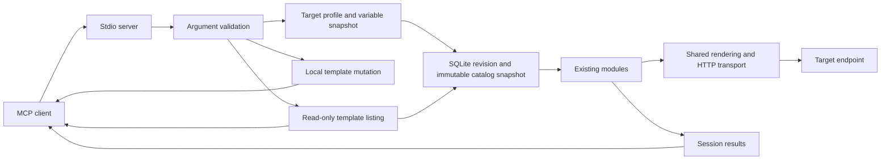

# Architecture

anticells_red_mcp exposes twelve tools for research and catalog discovery through a local stdio server.

## Execution

The console entry point is synchronous and starts an asyncio server. The installers print client configurations that launch the installed virtual-environment Python directly: `.venv\Scripts\python.exe` on Windows or `.venv/bin/python` on macOS/Linux. The optional macOS/Linux Bash launcher resolves source paths independently of the caller's directory. Windows uses the Proactor event loop for native pipes, subprocesses, and thread callbacks; Unix retains the local self-pipe workaround. Diagnostics go to stderr; stdout carries JSON-RPC messages.

Each endpoint call receives a configuration copy, avoiding cross-talk between concurrent targets. Module clients close when a call ends. Dataclass and dictionary results normalize to JSON records; original Unicode templates serialize with escapes so unpaired surrogates do not break the UTF-8 transport.

`mcp_server/targets.py` validates saved and inline definitions, explicitly loads selected environment files, and creates immutable snapshots. `modules/utils/chat_endpoint.py` renders JSON values and normalizes mapped replies while retaining the HTTP response for status, timing, headers, and fingerprint metadata. Request prompts are passed explicitly by each module, including the injection payload. Missing variables raise configuration errors through module and loop boundaries; they do not become failed model attempts. Background errors appear in the session report.

The background loop receives its own engine and target configuration. A second start is rejected while a loop is active. Stopping cancels and awaits the task. Starting again creates a fresh engine; completed records remain available through the session report. The default cap is one strategy iteration. Explicit zero removes the cap; `depth_first` still ends after one traversal.

## Existing catalogs

`list_attack_templates` reads the same immutable catalog snapshot used by execution. It defaults to enabled entries in the five public catalogs, with optional auxiliary/disabled entries, literal text search, category membership filters, and full definitions. Pagination includes the catalog revision; clients can require it on subsequent pages. Listing does not construct attack modules, contact targets, or allocate a report run. The original eight tools retain their argument schemas.

`get_compatible_templates` resolves a target snapshot and checks the public catalog against its request/response configuration and supplied function schemas. Pure request builders and tool-schema checks are shared with execution. It filters before pagination, can return safe exclusion reasons, and labels local mutation separately. It does not contact targets, create HTTP clients, or allocate report runs. Auxiliary catalogs are outside this compatibility interface.

`execute_attack_template` selects one enabled public record by stable ID from the call's catalog snapshot, optionally checking its revision. It reuses compatibility checks and invokes the corresponding engine's single-entry `execute()` method. Incompatible scenarios record one skip; invalid configuration records no failed target attempt. Existing recorder decorators capture each executed result once. The run stores template provenance, and the handler adds the result to current-session history and closes the engine's client. Local mutation takes no target arguments and produces one local result.

`get_fingerprint_profile` selects a bounded, weight-ordered set of primary fingerprint templates and validates every generated request before probing. It reuses `FingerprintScanner._probe()` and the existing model inference, while `modules/fingerprint/profile.py` assembles a profile separating observations and heuristic estimates. Existing probe decorators save full evidence once; the profile links result UUIDs and is stored in the run document without a new table or schema migration. Saved report views and exports retrieve it without catalog or target access.

Research MCP calls also pin a report run context. `reports/recorder.py` records each completed attempt before inline response limits, including fingerprint probes, local mutation, skipped scenarios, and chained attempts. SQLite writes run in worker threads and are serialized with an in-memory retry queue. Report evidence uses independent UUIDs and lossless BLOB encoding in a separate `reports.sqlite3`. OS session locks identify interrupted processes. Catalog outages do not prevent saved report retrieval.

`reports/repository.py` owns migrations, consistent snapshots, export registration, bounded reads, and explicit deletion. `reports/model.py` builds a canonical document for JSON, Markdown, and static HTML. `get_attack_report` retains its legacy default view and adds saved views, listing, exporting, and chunk retrieval. MCP resources resolve only registered export IDs. The `anticells_red_mcp-reports` CLI operates without a catalog or target. See [saved reports](reports.md).

MCP report and export-resource listings default to the current session. Explicit run/session selectors permit saved history retrieval; the reports CLI can discover runs across sessions. In-memory history buffers default to 2,000 records, while saved SQLite evidence remains until explicitly deleted.

All prompt content now comes from SQLite through `catalog/repository.py`. The server pins a complete immutable snapshot before constructing modules for each call or loop. A revision check refreshes the cached snapshot for new calls; active operations retain their original content. Supporting resources and auxiliary catalogs use the same repository. There is no runtime seed fallback. See [catalog configuration and authoring](catalogs.md).

Before MCP starts, `catalog/setup.py` resolves a configured SQLite path or defaults to a per-user application data file. It applies versioned migrations and seeds 496 records: 365 techniques across 21 namespaces and 131 supporting resources. Existing edits are preserved. SQLite write transactions serialize concurrent migrations and publications; reads use consistent transactions in worker threads. Set `ANTICELLS_RED_MCP_CATALOG_AUTO_SETUP=false` to require an initialized file without startup writes. The table below counts the original public entries, whose content, order, duplicate names, and category membership remain unchanged. The CLI can publish additions without adding MCP tools or changing their schemas.

| Module | Entries |
| :--- | ---: |
| Fingerprint | 30 |
| Jailbreak | 53 |
| Injection | 53 |
| Tool abuse | 35 |
| Mutation | 23 |

Regression checks preserve a canonical digest of the original five catalogs. Releases 1.0.1 and 1.0.2 add runtime fixes, documentation and branding, without adding catalog entries.

## Integration limits

The modules share JSON HTTP transport. Legacy `target_url` calls use optional `ANTICELLS_RED_MCP_TARGET_MODEL` and `ANTICELLS_RED_MCP_TARGET_API_KEY`; authenticated legacy calls are bound to the origin in `ANTICELLS_RED_MCP_TARGET_API_URL`. Custom `target` definitions support method, headers, JSON body, and JSON Pointer response mappings. Supplied bodies replace generated bodies, and custom headers own authentication. Inline definitions cannot read `${env.*}`. Environment-backed saved profiles must match the configured API origin and can read explicitly loaded file values or allowlisted process variables. See [target configuration](targets.md).

Primary and auxiliary HTTP clients share destination validation and DNS pinning at connection time. Default policy blocks private/loopback and metadata destinations; TLS verification is enabled, while inherited proxies and automatic redirects are disabled. Outbound budgets default to 20 requests per invocation and 500 per session per minute. The operator can change these controls through the settings in [SECURITY.md](../SECURITY.md).

Default text extraction supports chat-completions messages and simple `content` or `response` fields. Unknown objects and empty text fail scoring. Explicit text-only response mappings skip tool scenarios. The first version uses one HTTP request and one JSON reply per attempt, without streaming, login sequences, token refresh, response-derived variables, or automatic retries. Auxiliary Python-only engines outside the shared transport are deferred.

Provided tool schemas replace synthetic tool definitions for that call. Existing techniques with unavailable tools or incompatible arguments are skipped before HTTP delivery. Returned tool arguments must satisfy the selected schema; the server never executes the proposal.

Local mutation candidates and skipped records are excluded from endpoint attempt totals and success rates. Structured payloads remain dictionaries through mutation, variant creation and crossover; incompatible parent types retain a complete parent. Loop execution operates on copies of catalog entries.

Injection submits a payload through a chat message, including a system-role message in the existing implementation. It does not reproduce a lower-trust document, retriever, browser or persistent-memory boundary. The tool-abuse module submits synthetic tool-call scenarios; this server does not execute returned tool proposals.

Results retain legacy heuristics and can include failed requests. Confidence is not calibrated, model identity is not authenticated, and local mutation fitness is not target effectiveness. Review the underlying responses separately.
